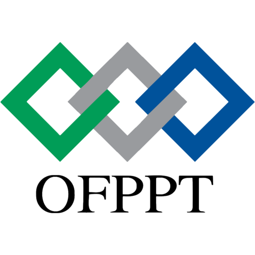

<!-- _class: lead -->
<!-- _paginate: false -->

# Product Backlog

## Definition, Role and Real-World Example

**Presented by:** Omar Mouttalie
**Supervised by**: ES-Sarraj Fouad

---

## Introduction

- Every product starts with **ideas, needs and expectations** from many people.
- Without organization, these needs get **lost, duplicated or misunderstood**.
- Agile and Scrum teams solve this with a single, living artifact: the **Product Backlog**.
- It keeps the whole team focused on **delivering the most value first**.

---

## Plan (Outline)

1. Introduction
2. Definition
3. Main body: role, characteristics and a real-world example
4. Problematic: life without a backlog
5. Solutions: what the backlog brings
6. Conclusion

---

## Definition

> The **Product Backlog** is an **ordered list** of everything needed to improve a product: features, fixes, improvements and technical work.

- Owned and prioritized by the **Product Owner**.
- It is the **single source of truth** for the work to be done.
- It is **never finished**: it evolves as the product and the market evolve.

---

## Main Body: Role of the Product Backlog

- **Captures** all needs from users, clients and stakeholders.
- **Prioritizes** work by business value, risk and effort.
- **Feeds** the Sprint Backlog: the team pulls the top items each sprint.
- **Aligns** the team, the Product Owner and stakeholders around one vision.
- **Adapts** to change: items can be added, reordered or removed anytime.

---

## Main Body: Characteristics of a Good Backlog (DEEP)

| Letter | Meaning | Explanation |
|---|---|---|
| **D** | Detailed appropriately | Top items are precise, lower ones stay rough |
| **E** | Emergent | Evolves with feedback and learning |
| **E** | Estimated | Each item has an effort estimate |
| **P** | Prioritized | Most valuable items come first |

---

## Main Body: Anatomy of a Backlog Item

- **User Story:** *As a [user], I want [goal], so that [benefit].*
- **Acceptance criteria:** conditions that prove the item is done.
- **Priority:** its rank in the list.
- **Estimate:** story points or time.
- **Item types:** feature, bug, improvement, technical task.

---

## Main Body: Real-World Example

**Food delivery mobile app**

- **Customer:** orders meals and tracks delivery.
- **Restaurant:** manages menu and receives orders.
- **Driver:** accepts and delivers orders.
- **Admin:** monitors the platform and handles complaints.

The Product Owner collects their needs and turns them into backlog items.

---

## Main Body: Example Backlog

| Priority | User Story | Points |
|---|---|---|
| P1 | As a customer, I want to browse restaurants and menus. | 5 |
| P2 | As a customer, I want to place and pay for an order. | 8 |
| P3 | As a driver, I want to receive delivery requests. | 8 |
| P4 | As a customer, I want to track my order live. | 5 |
| P5 | As a customer, I want to rate a restaurant. | 3 |

---

## Main Body: From Backlog to Delivery

1. **Product Backlog:** all needs, ordered by value.
2. **Sprint Planning:** the team selects the top items.
3. **Sprint Backlog:** items committed for the sprint.
4. **Increment:** working product delivered at the end.
5. **Review and refinement:** feedback updates the backlog.

---

## Problematic: Without a Product Backlog

- **Lost requirements:** ideas live in emails, chats and memory.
- **No clear priorities:** the team works on low-value tasks.
- **Scope creep:** uncontrolled changes delay delivery.
- **Misalignment:** stakeholders and developers expect different things.
- **Wasted budget:** features are built that nobody uses.

---

## Solutions: What the Product Backlog Provides

- **One central list:** every need is recorded and visible.
- **Clear priorities:** the highest value is always delivered first.
- **Transparency:** everyone sees what is planned and why.
- **Flexibility:** change is welcomed through continuous refinement.
- **Better planning:** estimates make forecasting realistic.

---

## Conclusion

- The Product Backlog is the **heart of Scrum and Agile product management**.
- It turns scattered needs into a **prioritized, actionable plan**.
- A well-maintained backlog means **less waste, more value, happier users**.

**Thank you for your attention!**