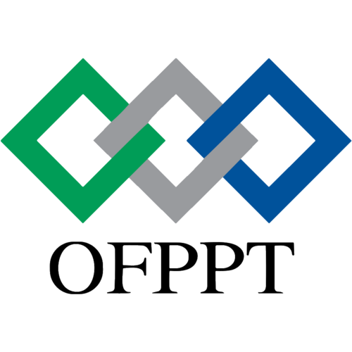

<!-- _class: lead -->
<!-- _paginate: false -->

# Fashion Store Dashboard
## Technical Project &  Labs

**Student Name:** Omar Mouttalie
**Supervisor:** ES-SARRAJ Fouad
**Institution:** OFPPT / Solicode  

---

## Technical Project Overview

### Single Page Application (SPA) — Fashion Store Management

* **Purpose:** Manage fashion store products with responsive, real-time UI interactions.
* **Backend Architecture:** Structured separation of concerns:
  * **Entity:** Data modeling & database ORM mapping
  * **Manager / Controller:** Business logic & API request routing
  * **API:** RESTful endpoints providing JSON data
* **Frontend UI:**
  * Clean UI state management & toast notifications
  * Fast rendering and responsive styling

---

## Technical Stack

| Layer | Technology | Role / Purpose |
| :--- | :--- | :--- |
| **Frontend Behavior** | **Alpine.js** | Lightweight UI behavior & dynamic reactive state |
| **Frontend Styling** | **Tailwind CSS** | Utility-first styling & layout design |
| **Backend App** | **PHP / Laravel** | Server-side logic, routing, controllers & API |
| **Data Storage** | **MySQL** | Relational database storage & entity mappings |

---

## Understanding Technical Labs

> ### What is a Lab?
> A focused, hands-on module designed to explore specific tools and test isolated technical solutions before full integration.

* **Why Conduct Labs?**
  * Test individual tools (Laravel APIs, Alpine state, Tailwind UI) in isolation.
  * Reduce technical risk before assembling the entire application.
  * Validate architectural patterns step by step.

* **Link with the Technical Project:**
  * Each Lab builds a direct piece of the final Fashion Store SPA (e.g., Database setup, API routes, Alpine UI components).

---

## Required Labs Roadmap

1. **Lab 1: Database Setup & Entity Modeling**
   * Configure MySQL schema and Laravel Eloquent models for products.

2. **Lab 2: Backend API & Controller Architecture**
   * Build REST API controllers, endpoints, and validation logic.

3. **Lab 3: Frontend UI Layout with Tailwind CSS**
   * Design the dashboard interface and product tables using Tailwind styling.

4. **Lab 4: Reactive UI & State with Alpine.js**
   * Implement SPA interactivity, dynamic forms, and toast notification popups.

5. **Lab 5: End-to-End Integration & Testing**
   * Connect Alpine.js frontend to Laravel API for full CRUD product management.